# Pràctica 4: phpMyAdmin

**Mòdul:** Implantació d'Aplicacions Web (IAW) · **Cicle:** 2ASIX  
**Objectiu:** instal·lar, configurar i protegir phpMyAdmin en Ubuntu/Kubuntu amb Nginx, MySQL i PHP-FPM, i documentar l'autenticació i l'automatització amb Bash.

> Aquesta memòria parteix dels passos i les captures de la pràctica realitzada. Les captures amb valors sensibles s'han redactat per a publicació: no s'hi publiquen contrasenyes ni hashes d'autenticació.

## 1. Instal·lació de phpMyAdmin

### 1.1. Instal·lar el paquet i les extensions PHP

Actualitzem la informació dels repositoris:

```bash
sudo apt update
```

Instal·lem phpMyAdmin i les extensions que demana el guió:

```bash
sudo apt install phpmyadmin php-mbstring php-zip php-gd php-json php-curl
```

Les extensions afegeixen suport per a cadenes multibyte, fitxers ZIP, funcions gràfiques, JSON i comunicacions mitjançant cURL. Durant l'assistent del paquet, el tutorial indica seleccionar `apache2` i acceptar `dbconfig-common`; a continuació pot demanar una contrasenya per a la base de dades auxiliar de phpMyAdmin.

**Nota:** encara que l'assistent del paquet ofereix `apache2`, el servidor web utilitzat en aquest entorn és Nginx. La integració amb Nginx es configura manualment en els passos següents.

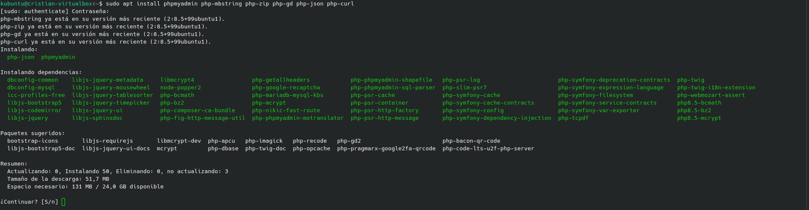

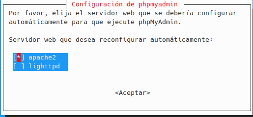

### 1.2. Comprovar el socket de PHP-FPM

Nginx no executa directament els fitxers PHP. Envia les peticions PHP al procés PHP-FPM mitjançant el socket Unix corresponent. Abans de configurar Nginx, comprovem el nom del socket:

```bash
ls -l /run/php/
```

En les captures de l'entorn utilitzat, el socket és `/run/php/php8.5-fpm.sock`. La ruta pot variar segons la versió de PHP instal·lada.

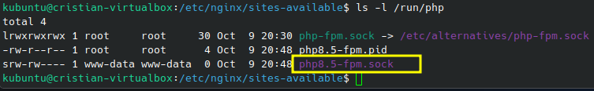

### 1.3. Configurar el site de Nginx

Editem el site actiu, en l'exemple:

```bash
sudo nano /etc/nginx/sites-available/default
```

Dins del bloc `server { ... }`, afegim el bloc `location` per servir phpMyAdmin. El fitxer `conf/site_phpmyadmin` inclòs en aquest repositori conté el bloc que s'ha d'integrar en el site. Cal utilitzar la ruta real del socket de PHP-FPM que apareix dins de `/run/php/`.

- `root /usr/share/;`: defineix la base de la ruta dels fitxers; `/phpmyadmin/index.php` correspon a `/usr/share/phpmyadmin/index.php`.
- `index`: defineix els fitxers d'índex.
- `try_files $uri =404`: retorna 404 si el fitxer no existeix.
- `fastcgi_pass`: envia la petició al socket PHP-FPM.
- `fastcgi_param SCRIPT_FILENAME`: comunica a PHP-FPM la ruta completa del script.
- `include /etc/nginx/fastcgi_params`: carrega paràmetres comuns de FastCGI.

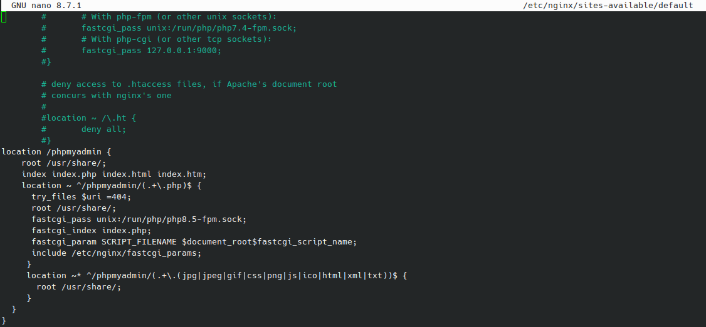

Comprovem que la configuració no té errors de sintaxi:

```bash
sudo nginx -t
```

Si el resultat indica `syntax is ok` i `test is successful`, podem aplicar els canvis:

```bash
sudo systemctl restart nginx
sudo systemctl status nginx --no-pager
sudo systemctl reload nginx
```

`restart` reinicia el servei; `reload` demana que Nginx torne a carregar la configuració sense fer un reinici complet del procés. Per a canvis de configuració, és habitual executar primer `nginx -t` i després `reload`.

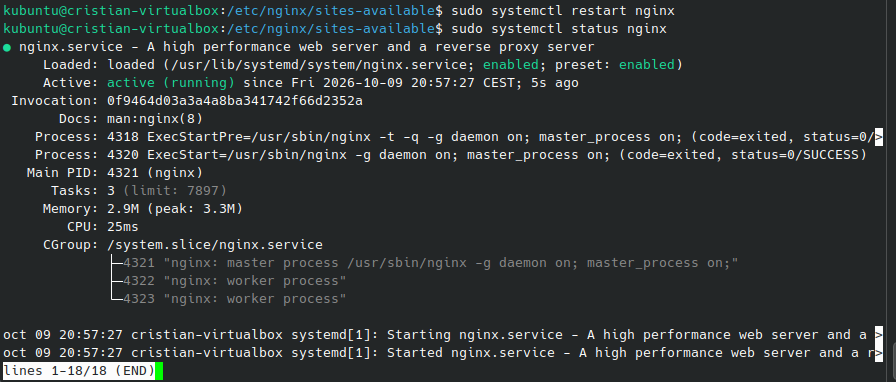

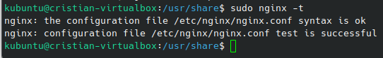

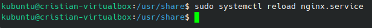

Finalment, comprovem l'adreça local: `http://localhost/phpmyadmin/`.

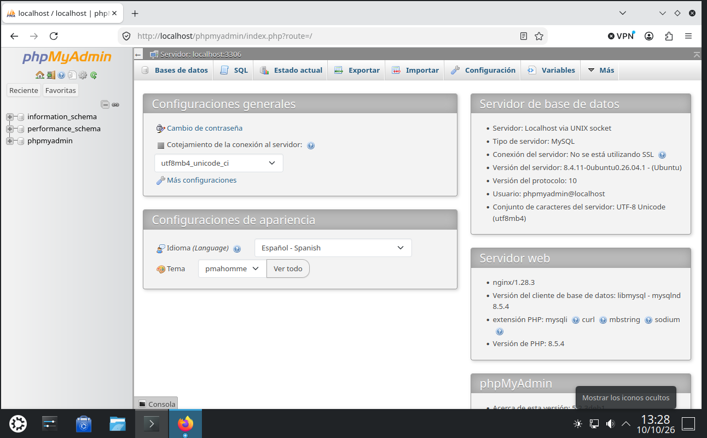

## 2. Permetre l'accés per contrasenya del compte root de MySQL

El tutorial explica que algunes instal·lacions Ubuntu configuren `root` amb el plugin `auth_socket`. Amb aquest mètode, l'autenticació depén de l'usuari del sistema i no necessàriament d'una contrasenya de MySQL. Per permetre l'inici de sessió des de phpMyAdmin, la pràctica proposa un plugin d'autenticació per contrasenya, com ara `caching_sha2_password`.

Primer, provem l'accés amb contrasenya:

```bash
mysql -u root -p
```

Per consultar els mètodes d'autenticació sense mostrar els hashes de les contrasenyes, executem:

```sql
SELECT user, plugin, host
FROM mysql.user
ORDER BY user, host;
```

El camp `plugin` identifica el mètode d'autenticació; `host` mostra des d'on es permet connectar cada compte. En l'entorn documentat, `root` utilitza `caching_sha2_password`, no `auth_socket`.

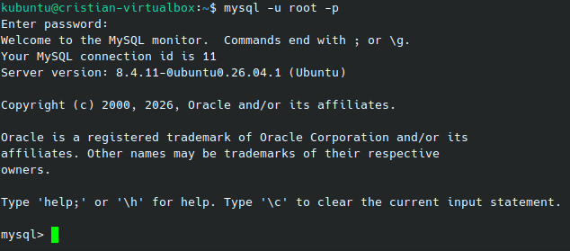

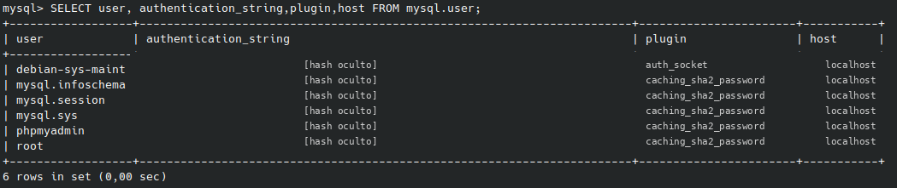

Si `root` encara apareix amb `auth_socket` i el guió exigeix autenticació per contrasenya, es pot configurar amb una contrasenya forta. Substituïu el text de mostra; no publiqueu el secret:

```sql
ALTER USER 'root'@'localhost'
IDENTIFIED WITH caching_sha2_password BY 'CANVIEU_AQUESTA_CONTRASENYA';
```

Després tornem a consultar els usuaris per verificar el plugin. No cal repetir aquest canvi si `root` ja està configurat correctament.

## 3. Crear un usuari dedicat de MySQL

La pràctica també demana crear un compte diferent de `root` per administrar bases de dades mitjançant phpMyAdmin. En les captures s'utilitza el nom `admin`; s'ha ocultat la contrasenya abans de publicar la imatge.

```sql
CREATE USER 'admin'@'localhost' IDENTIFIED BY 'CANVIEU_AQUESTA_CONTRASENYA';
```

El tutorial mostra una concessió global de privilegis, inclosa la possibilitat de concedir privilegis a altres usuaris:

```sql
GRANT ALL PRIVILEGES ON *.* TO 'admin'@'localhost' WITH GRANT OPTION;
FLUSH PRIVILEGES;
```

Aquesta concessió és molt àmplia: permet administrar totes les bases de dades i delegar privilegis. És la variant que apareix en les captures de la pràctica, però només s'hauria d'utilitzar en un laboratori quan es necessite explícitament aquest nivell. Per limitar l'usuari a una base de dades concreta, és preferible:

```sql
GRANT ALL PRIVILEGES ON nom_base_dades.* TO 'admin'@'localhost';
```

Substituïu `nom_base_dades` pel nom real. Podem verificar els privilegis amb:

```sql
SHOW GRANTS FOR 'admin'@'localhost';
```

Finalment, provem d'iniciar sessió en phpMyAdmin amb el compte dedicat.

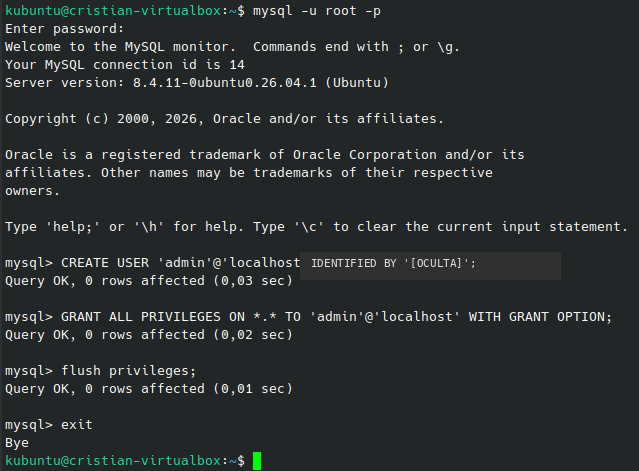

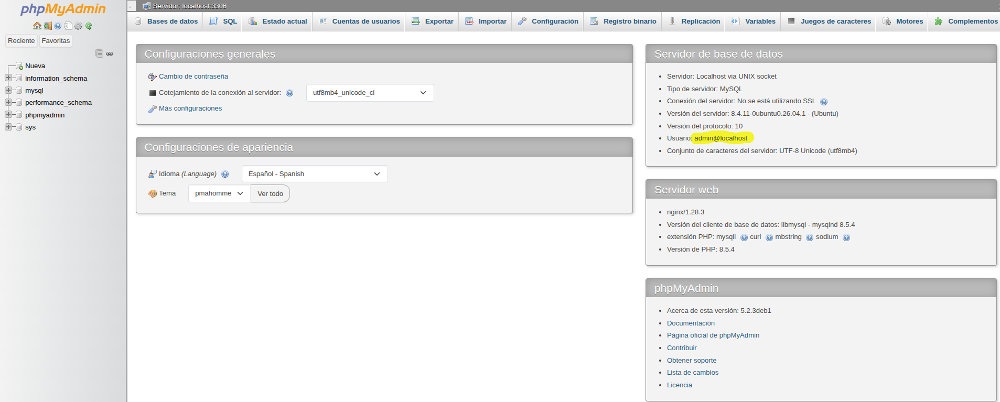

## 4. Protegir la instància de phpMyAdmin

La protecció afegeix autenticació HTTP bàsica de Nginx davant de l'inici de sessió de phpMyAdmin. És diferent de l'autenticació de MySQL: són dues capes d'autenticació.

### 4.1. Instal·lar `htpasswd`

Instal·lem el paquet que proporciona l'eina:

```bash
sudo apt install apache2-utils -y
```

Creem el primer usuari i el fitxer de credencials:

```bash
sudo htpasswd -c /etc/nginx/.htpasswd admin
```

L'ordre demana la contrasenya de manera interactiva. Per afegir un segon usuari al mateix fitxer, no utilitzem `-c`, perquè aquesta opció crea o sobreescriu el fitxer:

```bash
sudo htpasswd /etc/nginx/.htpasswd admin2
```

Les contrasenyes es guarden com a hashes. No publiqueu el fitxer `.htpasswd` ni captures que mostren els seus valors.

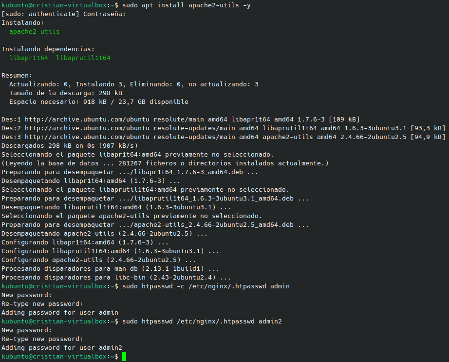

### 4.2. Configurar l'autenticació HTTP en Nginx

En el bloc `location /phpmyadmin`, afegim:

```nginx
auth_basic "Accés restringit";
auth_basic_user_file /etc/nginx/.htpasswd;
```

`auth_basic` defineix el missatge del diàleg d'autenticació; `auth_basic_user_file` assenyala el fitxer amb els usuaris i els hashes. El fitxer `conf/site_phpmyadmin` mostra el bloc complet, incloses aquestes directives.

Comprovem i recarreguem la configuració:

```bash
sudo nginx -t
sudo nginx -s reload
```

En obrir `http://localhost/phpmyadmin/`, el navegador demana primer l'usuari i la contrasenya del fitxer `.htpasswd`. Després phpMyAdmin demana les credencials del compte de MySQL.

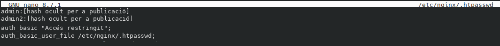

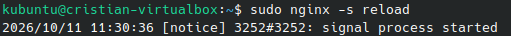

### 4.3. Protegir els permisos del fitxer `.htpasswd`

Assignem `root` com a propietari i `www-data` com a grup:

```bash
sudo chown root:www-data /etc/nginx/.htpasswd
```

Limitem els permisos:

```bash
sudo chmod 640 /etc/nginx/.htpasswd
```

`640` significa que el propietari té lectura i escriptura (`6`), el grup només té lectura (`4`) i la resta d'usuaris no tenen permisos (`0`). Això permet que Nginx puga llegir el fitxer a través del grup `www-data`, però impedeix que altres usuaris del sistema el lligen.

Verifiquem el resultat:

```bash
ls -l /etc/nginx/.htpasswd
```

La sortida esperada comença amb `-rw-r-----` i mostra `root www-data` com a propietari i grup.

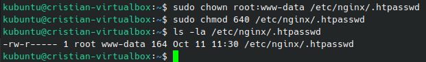

## 5. Automatització amb scripts Bash

El lliurament demana un directori `scripts` amb `.env`, `install_lemp.sh` i `install_phpmyadmin.sh`:

- `scripts/.env`: conté rutes i opcions no secretes.
- `scripts/install_lemp.sh`: instal·la els paquets de LEMP i activa els serveis disponibles.
- `scripts/install_phpmyadmin.sh`: instal·la phpMyAdmin, detecta el socket PHP-FPM, prepara el fragment Nginx, sol·licita credencials de `htpasswd` de manera interactiva i ajusta els permisos.

Per executar-los en un entorn nou:

```bash
chmod +x scripts/install_lemp.sh scripts/install_phpmyadmin.sh
./scripts/install_lemp.sh
./scripts/install_phpmyadmin.sh
```

Els scripts són automatitzacions per a una instal·lació nova i necessiten `sudo`. Reviseu el fitxer del site i feu una còpia de seguretat abans d'executar-los en una màquina ja configurada. Si ja existeix `location /phpmyadmin`, l'script evita crear un bloc duplicat i indica que cal integrar manualment les directives d'autenticació.

## 6. Estructura del repositori

```text
.
├── README.md
├── index.md
├── _config.yml
├── .gitignore
├── conf/
│   └── site_phpmyadmin
├── scripts/
│   ├── .env
│   ├── install_lemp.sh
│   ├── install_phpmyadmin.sh
│   └── insert_nginx_include.py
└── capturas/
    ├── instalacion/
    ├── autenticacion/
    └── proteccion/
```

## 7. Seguretat i conclusions

- No publiqueu contrasenyes reals, `.htpasswd`, claus privades ni hashes d'autenticació.
- L'autenticació HTTP bàsica i l'autenticació de MySQL són capes diferents.
- Manteniu MySQL limitat a `localhost` quan no siga necessari l'accés remot.
- La consulta `SELECT user, plugin, host FROM mysql.user;` verifica mètodes sense mostrar `authentication_string`.
- Limiteu els privilegis SQL a les bases de dades que l'usuari necessite gestionar.
- Abans de canviar Nginx, executeu `sudo nginx -t`; després apliqueu els canvis amb `sudo systemctl reload nginx`.

## Recursos

- [Tutorial de la unitat: phpMyAdmin — IAW 2ASIX UD02](https://espemm.github.io/IAW-2ASIX/ud2/IAW2-phpmyadmin/)
- [Documentació de phpMyAdmin](https://docs.phpmyadmin.net/)
- [Documentació de MySQL](https://dev.mysql.com/doc/)
- [Documentació de Nginx](https://nginx.org/en/docs/)
